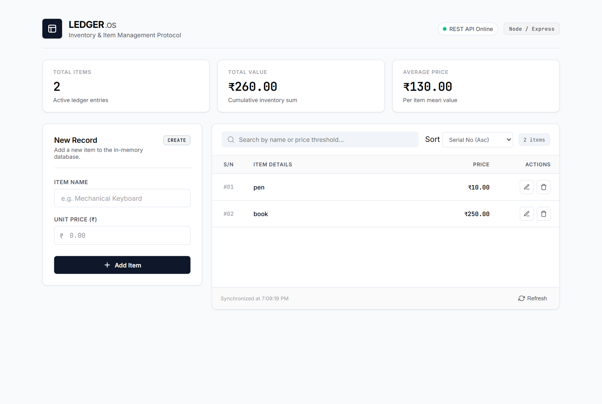
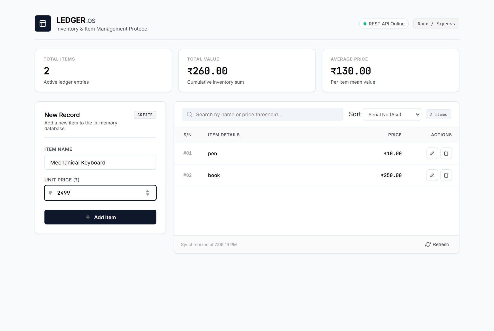
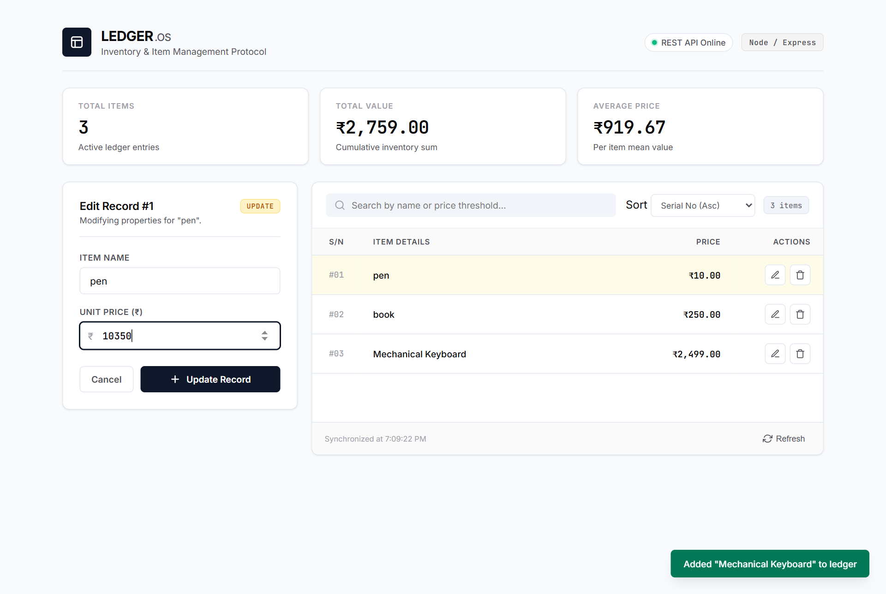
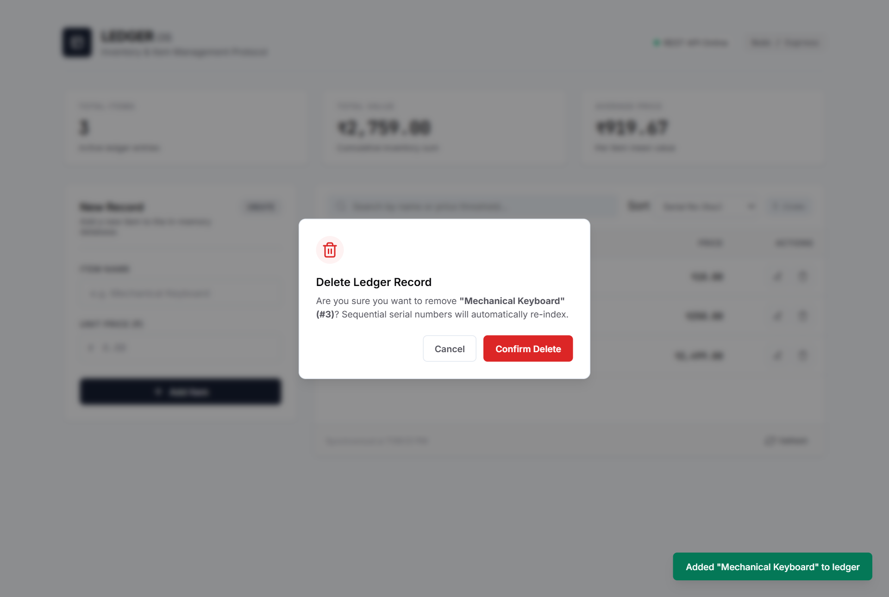
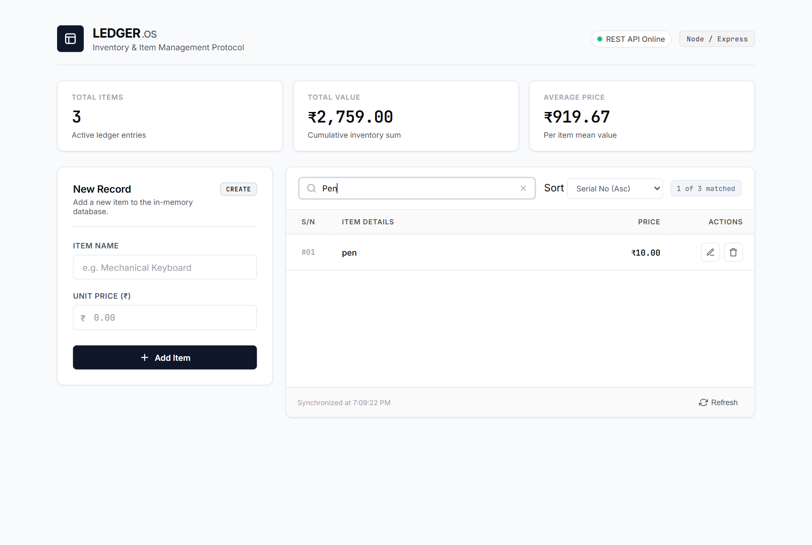

# LEDGER.OS — Smart Inventory & Item Management System

A high-performance, minimalist item management and inventory tracking web application built with Node.js, Express, and modern JavaScript. Features continuous serial re-indexing, real-time search filtering, dynamic metrics calculation, and a clean fintech-inspired user interface.

---

## 📸 Output & Application Walkthrough

### Figure 1: Starting Phase (Dashboard Overview)
Initial application state on page load. Displays active inventory items, real-time REST API status indicator, and dynamic KPI metric cards (Total Items, Total Valuation, Average Price).


---

### Figure 2: POST Operation (Creating a New Item)
Entering new product attributes (`Name: Mechanical Keyboard`, `Price: ₹2499.00`) in the Create panel. Upon submission via `POST /items`, the item is added to the in-memory store and serial numbers are updated.


---

### Figure 3: PUT Operation (Updating an Item)
Clicking the edit action triggers `UPDATE` mode, populating the input fields with the existing record data. Updating the price and submitting sends a `PUT /items/:id` request to persist modifications.


---

### Figure 4: DELETE Operation (Confirmation Modal & Re-indexing)
Clicking the delete action triggers a custom confirmation modal to prevent accidental loss. Confirming sends a `DELETE /items/:id` request, automatically re-sequencing all remaining items to maintain strict consecutive order (`#01`, `#02`, etc.) with zero ID gaps.


---

### Figure 5: Real-Time Search & Filtering
Live keyword search instantly filters the ledger table by item name or price without requiring page reloads, displaying a real-time counter of matched records.


---

## ✨ Key Features

- **Full CRUD Operations**:
  - **Create (POST)**: Add new items with real-time validation.
  - **Read (GET)**: Fetch and display items with continuous serial numbers (`#01`, `#02`, etc.).
  - **Update (PUT)**: Pre-fill form fields, toggle edit mode, and save changes inline.
  - **Delete (DELETE)**: Custom modal confirmation preventing accidental deletions.
- **Continuous Sequential Re-indexing**: Automatically recalculates continuous serial numbers whenever records are removed.
- **Real-Time Search & Filter**: Instantly filter records by item name or price threshold without reloading.
- **Multi-criteria Sorting**: Sort items by Serial Number (Asc/Desc), Price (Low to High / High to Low), or Item Name (A to Z).
- **Live KPI Analytics Strip**: Dynamically computes **Total Items**, **Total Inventory Valuation**, and **Average Unit Price**.
- **Minimalist Fintech UI**: Clean monochrome typography (Inter & JetBrains Mono), custom toast notifications, and zero external frontend dependencies for maximum speed and simplicity.

---

## 🛠️ Technology Stack

| Layer | Technology |
|---|---|
| **Backend** | Node.js, Express 5 |
| **Frontend** | Vanilla JavaScript (ES6+), HTML5, Modern CSS3 (Variables, Flexbox, Grid) |
| **Fonts** | Inter, JetBrains Mono |
| **Architecture** | RESTful API + Static File Serving |

---

## 📡 REST API Reference

| Method | Endpoint | Description | Request Body | Response |
|---|---|---|---|---|
| `GET` | `/items` | Retrieve all inventory items | None | `200 OK` (Array of items) |
| `POST` | `/items` | Create a new item | `{ "name": "string", "price": number }` | `201 Created` (New item object) |
| `PUT` | `/items/:id` | Update an existing item | `{ "name": "string", "price": number }` | `200 OK` (Updated item object) |
| `DELETE` | `/items/:id` | Delete an item & re-sequence IDs | None | `200 OK` (Status message & re-sequenced items) |

---

## 🚀 Getting Started

### Prerequisites
- [Node.js](https://nodejs.org/) (v16 or higher)
- npm (Node Package Manager)

### Installation & Run

1. **Clone the repository:**
   ```bash
   git clone https://github.com/AkashNayak1223/smart-inventory-ledger.git
   cd smart-inventory-ledger
   ```

2. **Install dependencies:**
   ```bash
   npm install
   ```

3. **Start the server:**
   ```bash
   node server.js
   ```

4. **Access the application:**
   Open your browser and navigate to:
   ```
   http://localhost:3000
   ```

---

## 📁 Project Structure

```
smart-inventory-ledger/
├── public/
│   ├── index.html        # Clean semantic application markup
│   ├── script.js         # REST client, real-time search & filter, KPI metrics, modal logic
│   └── style.css         # Fintech design system, typography, and responsive grid
├── screenshots/          # Output demonstration figures (POST, PUT, DELETE, Search)
│   ├── fig1_initial_state.png
│   ├── fig2_post_add_item.png
│   ├── fig3_put_update_item.png
│   ├── fig4_delete_modal.png
│   └── fig5_search_filter.png
├── package.json          # Project metadata and Express dependency
├── package-lock.json     # Dependency lockfile
├── server.js             # Express REST API & sequential re-indexing controller
└── README.md             # Project documentation & output walkthrough
```

---

## 📄 License
This project is open-source and available under the [ISC License](LICENSE).
